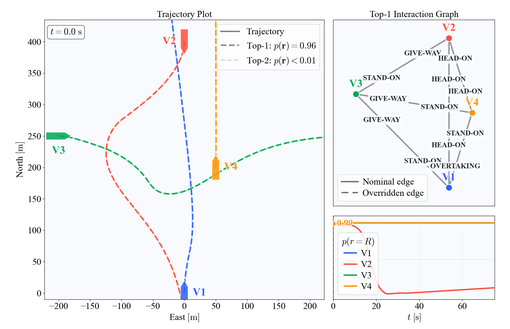

# colregs-planner

COLREGs-aware multi-vessel trajectory prediction and own-ship manoeuvre
planning. Code for **"COLREGs-Aware Multi-Vessel Trajectory Prediction via Interaction
Hypothesis Inference and Velocity-Obstacle Rollout."**

Each vessel's trajectory is predicted in two layers. A *nominal* layer predicts
where the vessel would go without other traffic. An *interaction-aware* layer
assigns COLREGs roles between vessel pairs, estimates which vessels actually
respond to their obligations, and predicts the resulting maneuvers with a
velocity-obstacle (VO) rollout.



## Install

Python 3.11 or newer. From PyPI:

```bash
pip install colregs-planner             # prediction, planner, ColregsDPPlanner
pip install "colregs-planner[all]"      # plus AIS processing, nominal library, plots, sea charts
```

Extras: `nominal` (track library), `ais` (AIS processing and library
building), `sim` (simulation configs and plots), `seachart`, `plots`.

```python
from colregs_planner import ColregsDPPlanner, Route   # see "DP reference for an own ship"
```

The simulation and AIS scripts live in the repository, not in the package. To
run them, install from source:

```bash
git clone https://github.com/johannesskaro/multi-vessel-prediction.git
cd multi-vessel-prediction
python -m venv venv
venv\Scripts\activate          # Windows;  source venv/bin/activate on Linux/macOS
python --version               # must be 3.11 or newer
pip install -e ".[all,test]"
```

If `python --version` shows an older version, another Python comes first on your
PATH. Delete the `venv` folder and create it with a specific version instead:
`py -3.13 -m venv venv` on Windows (`py --list` shows the installed versions), or
`python3.13 -m venv venv` on Linux/macOS.

## Quick start

The simulations need no data:

```bash
python scripts/run_simulation.py --config scenarios/simulation/multi_vessel.yaml
```

This is the four-vessel scenario from the paper (Fig. 2): V2 does not respond,
and the others adapt once the filter detects it. Controls in the plot window:
**Space** pause/resume, **S** save the frame to `outputs/frames/`, **Q** quit.
Useful flags: `--save` writes a GIF to `outputs/`, `--stop-time 20.5` pauses and
saves a frame at that time, `--record` saves a video.

## Simulation scenarios

| Config | Scenario |
|---|---|
| `head_on.yaml` | two vessels head-on, both responsive |
| `crossing.yaml` | two vessels crossing, the target does not respond |
| `overtaking.yaml` | two vessels overtaking, the target does not respond |
| `overtaking_ahead.yaml` | ego overtakes a slower vessel dead ahead; the pass is far beyond a short planning horizon |
| `head_on_crossing.yaml` | head-on plus a non-responsive crossing vessel |
| `multi_crossing.yaml` | ego and three crossing vessels; ego is non-responsive, the others must avoid it |
| `multi_crossing_give_way.yaml` | the same with a responsive ego: give-way to two starboard crossers while stand-on to a port crosser |
| `multi_vessel.yaml` | four vessels, one non-responsive (paper Fig. 2) |
| `give_way_stop.yaml` | ego gives way to a close crosser from starboard while a vessel alongside blocks a starboard turn; stopping is the clean solution |

### Changing a scenario

Copy a config in `scenarios/simulation/` and edit it. The vessels are listed
under `scenario.vessels`. The vessel named `ego` starts at the origin; every other
vessel is placed relative to it:

```yaml
scenario:
  dt: 0.5                       # time step [s]
  t_horizon: 75.0               # simulation length [s]
  vessels:
    ego:
      speed: 5.0                # [m/s]
      heading: 0.0              # [deg], 0 = north, 90 = east
      policy: vo_analytic
      sim_model: ct_decoupled_ar
      intent: responsive
      d_pass: 75.0              # desired passing distance [m]

    target_1:                   # add vessels by adding blocks like this one
      encounter: head_on        # where it starts, relative to ego (see below)
      range: 400.0              # distance from ego [m]
      speed: 5.0
      policy: vo_analytic
      sim_model: ct_decoupled_ar
      intent: non_responsive    # holds its course and ignores all traffic
      d_pass: 75.0
```

- **Start position.** `encounter` and `range` place a vessel relative to ego:

  | `encounter` | Start position and course |
  |---|---|
  | `head_on` | ahead, on the reciprocal course; `lateral_offset_m` shifts it sideways |
  | `crossing_starboard` | on ego's starboard side, crossing to port |
  | `crossing_port` | on ego's port side, crossing to starboard |
  | `overtaking_ahead` | ahead, same course (ego overtakes), 50 m to starboard (`lateral_offset_m` overrides) |
  | `overtaking_astern` | astern, same course (it overtakes ego), 50 m to starboard (`lateral_offset_m` overrides) |

  Crossing vessels are timed to reach the crossing point together with ego. The
  COLREGs roles are not taken from `encounter`: they are classified from the
  vessel states at every step, as in the paper.
- **Responsiveness.** `intent: responsive` vessels follow their COLREGs
  obligations. `intent: non_responsive` vessels keep their course whatever
  happens. The filter has to discover this from their motion. Play around by setting different vessels as non_responsive to see how that changes the predictions.
  A vessel planned by `predictor_dp` or `search_dp` is the own ship under our
  control and always follows COLREGs, so it cannot be `non_responsive`; give a
  non-responsive `ego` a plain policy such as `vo_analytic` (as in
  `multi_crossing.yaml`).
- **Behavior.** Any VO parameter (see [Parameters](#parameters)) can be set per
  vessel, e.g. `d_pass` or `course_budget_deg`. Names are checked, so a typo
  gives an error.
- **Motion model.** `sim_model` sets how a vessel's motion is simulated:
  `ct_decoupled_ar` (default in the configs), `ct_coupled_ar`, `viknes_ar`, `cv`,
  or `milliampere` (see below).

### milliAmpere own ship

`sim_model: milliampere` simulates a vessel with the 3DOF maneuvering model of
the milliAmpere autonomous ferry and its controllers (ported from liteAmpere
into `colregs_planner/motion_models/milliampere_model.py`). How the hull is driven depends
on the vessel's `policy`:

- `predictor_dp`: dynamic positioning on a moving reference. Every step the
  predictor (top-1 hypothesis, the dashed line in the plot) is rolled out one
  step from the current states, and the reference moves by the vessel's
  predicted step and turns to its predicted course. The vessel is the own
  ship under our control, so it is always responsive, not estimated. The DP law is
  liteAmpere's with its damping moved onto the velocity error and the hull's
  drag at the reference velocity fed forward, so the hull stays within
  ~0.1 m of the reference instead of trailing it by 10–17 m.
- any VO policy (e.g. `vo_analytic`): the policy's desired velocity becomes
  heading and speed commands for liteAmpere's course and speed controllers.
- `search_dp`: dynamic positioning along a plan chosen by search. Every
  `replan_s` (default 5 s) the own ship scores every sequence of two 7.5 s
  manoeuvres from {nominal, starboard 30°, starboard 60°, port 30°, half speed,
  stop},
  each rolled out with the prediction model while the other vessels react to
  it, under the top-2 responsiveness hypotheses. The cost weighs passing
  distance (with `bow_factor` × `d_pass`, default 2, required when crossing
  ahead of a vessel; expected, and worst case over the hypotheses with at least 10 %
  probability, so a stand-on own ship holds course until the filter actually
  doubts the give-way vessel), COLREGs (starboard
  in head-on and act early when giving way, both while the route course would
  still pass inside `d_pass`, hold when standing on unless bound
  to keep clear of another vessel, no port turns
  toward a give-way encounter, alter course early when overtaking), deviation
  from the route, manoeuvre effort,
  time lost along the route, and switching away from a manoeuvre less than
  one edge old. Code in
  `colregs_planner/planner_api/manoeuvre_search.py`; tune with a per-vessel
  `search: {depth, edge_s, plan_dt, horizon_s, top_k}` block.
  A vessel being overtaken only costs a collision until the TCPA on the
  route course is below the predictor's `tcpa_threshold`. From then on, the
  passing distance also counts the straight-line CPA after the horizon.
  While the route course would also pass inside the overtaking `d_pass`, a
  plan must alter course away from the vessel on its first edge, not slow
  down behind it. No edge may turn back toward it until the own ship is past.
  The plot draws the own ship along its committed plan, with the others
  reacting to it, and the console lists each plan made.

`--ego-policy` overrides ego's policy from the command line, for comparisons:

```bash
python scripts/run_simulation.py --config scenarios/simulation/milliampere/crossing.yaml --ego-policy search_dp
```

The model is identified for speeds up to about 2 m/s, so the ship-scale
scenarios are too fast for it. `scenarios/simulation/milliampere/` holds the
same scenarios with every length and speed scaled by 0.3 (ego at 1.5 m/s) and
ego on the milliAmpere model with `predictor_dp`:

```bash
python scripts/run_simulation.py --config scenarios/simulation/milliampere/multi_vessel.yaml
python scripts/tools/scale_scenarios.py      # regenerate them after editing the originals
```

Because times are unchanged, horizons and TCPA thresholds carry over as they
are. Lengths that live outside the vessel blocks are scaled too: the COLREGs
classifier distances (`scenario.classifier: {d_u, dcpa_max, d_a}`, defaults
150 m, 1500 m, 10 km) and the overtaking start offset (`lateral_offset_m`,
default 50 m for overtaking encounters).

The `prediction` block sets what is predicted and shown:

```yaml
prediction:
  enabled: true
  horizon: 120.0               # prediction horizon [s]
  use_responding_filter: true  # estimate which vessels respond (2^N hypotheses)
  top_k_hypotheses: 2          # number of most likely hypotheses drawn (1 = only the best)
```

Plot options go under `viz`. `scenarios/viz_reference.yaml` lists all of them
with their defaults.

## Real AIS data

The real-data experiments use AIS data from the Oslofjord (Moss–Horten). The data
is not in the repository; it is shared separately as a `handover` folder. Put it
in the repository root:

```
handover/
  Moss Horten Feb 2026 AIS/processed/ais_01.pkl, ais_04.pkl   # encounter windows (test data)
  nominal_library_jan_26.h5                                    # nominal track library
  seacharts/moss_horten.gpkg                                   # sea chart (optional)
```

Run the three test windows from the paper:

```bash
python scripts/run_AIS.py --config scenarios/real/window_079.yaml                 # live playback
python scripts/run_AIS.py --config scenarios/real/window_098.yaml
python scripts/run_AIS.py --config scenarios/real/window_054.yaml
```

The sea-chart background needs `pip install -e ".[seachart]"`; without it the
plots have a plain background. `moss_horten.gpkg` is the Moss–Horten part of
Kartverket's depth data. For another area, download the full chart
(`Basisdata_0000_Norge_25833_Dybdedata_FGDB.gdb`) from Kartverket into
`seacharts/`, which is used when present, or crop it with
`scripts/tools/crop_seachart.py --bbox LAT_MIN LAT_MAX LON_MIN LON_MAX`. `scenarios/README.md` explains all config blocks.

To build the data yourself from the daily AIS files at
[Kystverket](https://ais.kystverket.no/):

```bash
python scripts/process_raw_ais.py --data-dir "data/<test period>" --out "data/<test period>/processed/ais_01.pkl"
python scripts/build_nominal_library.py --data-dir "data/<library period>" --out data/nominal_library.h5
python scripts/tools/browse_encounters.py --data "data/<test period>/processed/ais_01.pkl"   # find encounter windows
```

and point `data.pkl_path` and `prediction.nominal.library_path` in the config to
the new files.

To use the predictor in your own code:

```python
from colregs_planner.prediction.predictor import VesselPredictor
from colregs_planner.prediction.vo_rollout import VOAgentConfig

predictor = VesselPredictor(dt=2.0, H=300, use_responding_filter=True,
                            default_agent_config=VOAgentConfig(d_pass=100.0))
for states in stream:                      # dict: vessel id -> VesselState (NED)
    p_responsive = predictor.update(states)
    trajectories = predictor.predict()[0][0]   # most likely hypothesis
```

The full-horizon rollouts can run in parallel worker processes
(`colregs_planner/prediction/parallel.py`), with identical results:
`prediction.interaction.parallel_workers: N` in the real-data configs,
`prediction.parallel_workers: N` in the simulation configs, or
`VesselPredictor(..., parallel_workers=N)`. Live playback gains only when
`top_k_hypotheses > 1` (one worker per hypothesis); `--metrics` also runs the
rollouts of different frames in parallel, so it gains even with
`top_k_hypotheses: 1`. `parallel_workers: auto` picks this for you: one worker
per hypothesis live, all CPU cores but one for `--metrics`; it is the default
in both config types. Use 0 (serial) when debugging the rollout.

The planners use the same mechanism. A `search_dp` own ship in the simulation
gets a pool sized by `prediction.parallel_workers` (`auto`: one worker per
plan rollout, at most CPU cores − 1), and `PredictionService.evaluate_manoeuvres`
runs on the predictor's pool when the service config sets
`interaction.parallel_workers` (default 0 there). Results are the same either
way.

## Planner API

`colregs_planner/planner_api` wraps the predictor for use as an information source inside
a larger system, e.g. an AI planner. `PredictionService.step()` runs the full
predictor cycle once per observation; the `get_*` queries then read the cached
result and return JSON-serializable dicts, so they can be called as often as
needed without re-running the prediction or disturbing the responding filters.

```python
from colregs_planner.planner_api import PredictionService, TOOLS, call_tool

service = PredictionService.from_config("scenarios/real/window_079.yaml",
                                        dt=2.0, ref_lat=REF_LAT, ref_lon=REF_LON)
for t, obs in stream:     # {vessel_id: VesselState or {"north", "east", "speed", "course_deg"}}
    service.step(obs, t=t)

    service.get_encounters("ego")            # roles, encounter type, range, DCPA/TCPA, from ego's view
    service.get_responsiveness()             # P(vessel follows its COLREGs obligations)
    service.get_hypotheses()                 # responsiveness hypotheses + re-assigned roles
    service.get_predicted_cpa("ego")         # closest approach along the predicted trajectories
    service.get_predicted_trajectory("257123000", hypothesis=0, resolution_s=30)
    service.get_predicted_state("257123000", t=120)
    service.get_snapshot()                   # everything at once
```

`TOOLS` holds a JSON Schema definition for every query (Anthropic `tools=`
format; `tool_specs("parameters")` for frameworks that use that key), and
`call_tool(service, name, arguments)` dispatches a tool call, returning
`{"result": ...}` or `{"error": ...}`. Units: NED metres from the session
origin, degrees with 0 = north clockwise, m/s, seconds.

`python scripts/planner_api_demo.py` runs the API on a synthetic encounter
(no data needed); `--tools` prints the tool definitions.

Pass `own_id` for the own ship: its responsiveness is then fixed (it follows
COLREGs) instead of estimated, and the hypotheses only vary over the other
vessels. `service.evaluate_manoeuvre(own_id, course_change_deg, speed_factor,
duration_s)` predicts the closest approaches if the own ship starts that
manoeuvre now, with every other vessel reacting to it, under each hypothesis.

### DP reference for an own ship

`ColregsDPPlanner` (`colregs_planner/planner_api/dp_planner.py`) is the interface for
running the planner in another vessel system: vessel states in, dynamic
positioning (DP) reference out. It runs the same pipeline as the simulator's
`search_dp` own ship: responsiveness estimated from the observations, COLREGs
roles from the classifier, a manoeuvre search every `replan_s`, and the own
ship's track along the chosen plan as the DP reference.

```python
from colregs_planner.planner_api import ColregsDPPlanner, Route

planner = ColregsDPPlanner(
    own_id = "ego",
    route  = Route(north=0.0, east=0.0, course_deg=0.0, speed=1.5),  # straight leg
    dt     = 0.5,                                   # interval between update() calls [s]
    config = {"interaction": {"use_responding_filter": True, "top_k_hypotheses": 2,
                              "agent": {"d_pass": 30.0, "tcpa_threshold": 100.0}}},
    classifier = {"d_u": 45.0, "dcpa_max": 450.0, "d_a": 3000.0},
    parallel_workers = "auto",                      # worker processes for the rollouts
)
ref = planner.update(t, {"ego": own_state, "257123000": other_state, ...})
ref.north, ref.east, ref.heading_deg, ref.vn, ref.ve   # DP reference at t
planner.reference(t_now)                        # sample the committed plan at any rate
planner.set_route(next_leg)                     # onto the next leg of the route
```

States are `VesselState`s or dicts with `north`, `east`, `speed` and one of
`course_deg` / `heading_deg` / `psi`, in local NED metres. Call `update()` at a
fixed `dt` with every observed vessel, own ship included. Vessels slower than
0.5 m/s (e.g. at anchor) are planned around as holding position. A replan
takes about 0.05–0.2 s on one process. `python scripts/dp_planner_demo.py` runs it
on a synthetic head-on encounter.

## Parameters

The VO parameters and their defaults are the fields of `VOAgentConfig`
(`colregs_planner/prediction/vo_rollout.py`). They are set per vessel in the simulation
configs and under `prediction.interaction.agent` in the real-data configs.

| Parameter | Paper | Default | Meaning |
|---|---|---|---|
| `d_pass` | `D` | 100 m | desired passing distance |
| `los_lookahead` | `Δ` | 100 m | LOS lookahead back to the nominal track |
| `continuity_weight` | `λ` | 0.9 | penalty on changing the selected heading (Eq. 19) |
| `course_budget_deg` | | 70° | largest course change from the nominal course |
| `k_psi` | `k_ψ` | 0.1 s⁻¹ | turn-rate gain of the rollout motion model (Eq. 20) |
| `head_on_rvo_weight` | | 0.5 | share of the head-on maneuver each vessel takes (0.5 = RVO) |

The responding filter (`colregs_planner/prediction/responding_filter.py`) uses
`p(r₀=R) = 0.99` and `σ_ψ = 5°`. The COLREGs classifier
(`colregs_planner/colregs_graph/colregs_classifier.py`) uses `DCPA_max = 1500 m`. The nominal
predictor's `β`, search radius and history length are set under
`prediction.nominal` in the real-data configs.

## Differences from the paper

- **VO solver.** In the paper, a vessel must keep the full passing distance `D`
  from every vessel. When that is impossible, e.g. vessels already closer than
  `D` or several vessels blocking each other, the paper's solver gives extreme
  turns or sudden course switches. This solver instead keeps the largest passing
  distance that can be reached within `course_budget_deg`. When several vessels
  conflict, it reduces all passing distances together, the most for encounters
  furthest ahead in time. Speed is never changed, so every maneuver is a course
  change. See `solve_vo_achievable` in `colregs_planner/policies/vo_analytic.py`.
- **STAND-ON.** A responsive stand-on vessel still avoids a collision at the last
  moment (COLREGs Rule 17(b)), with a small passing distance `d_coll` =
  0.1·`d_pass`. In the paper, STAND-ON has no constraint. Non-responsive vessels
  ignore all traffic, as in the paper.

## Repository layout

```
scripts/
  run_simulation.py      simulations (scenarios/simulation/)
  run_AIS.py             real AIS playback, figures and metrics (scenarios/real/)
  planner_api_demo.py    planner API on a synthetic encounter
  dp_planner_demo.py     own-ship DP reference from vessel states (ColregsDPPlanner)
  process_raw_ais.py     raw AIS -> encounter windows
  build_nominal_library.py
  tools/                 encounter browsing, sea-chart cropping, deviation analysis, profiling
colregs_planner/        the package
  nominal/               nominal layer: track library and nearest-neighbor retrieval (Sec. III)
  colregs_graph/         COLREGs classifier and interaction graph (Sec. IV-A, IV-B)
  prediction/            responding filter, VO rollout, VesselPredictor (Sec. IV-C, V)
  planner_api/           PredictionService queries and tool definitions for planners
  policies/              VO solvers (vo_analytic: this work, vo_kuwata: Kuwata et al.), CTO
  motion_models/         kinematic models used in simulation and rollout
  vessel/, ais/, visualization/, seachart/
scenarios/               run configurations
```

## Development

`main` holds the code used for the paper. Make changes on your own branch and
open a pull request to merge them, instead of pushing to `main`:

```bash
git switch main && git pull
git switch -c <your-name>/<topic>      # e.g. anna/new-scenario
# ... edit, then commit
git push -u origin <your-name>/<topic>
```
